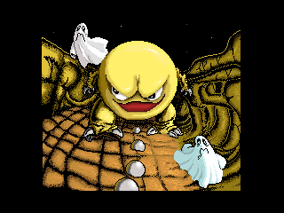
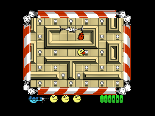
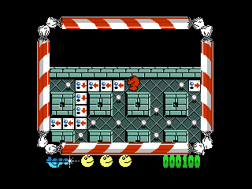
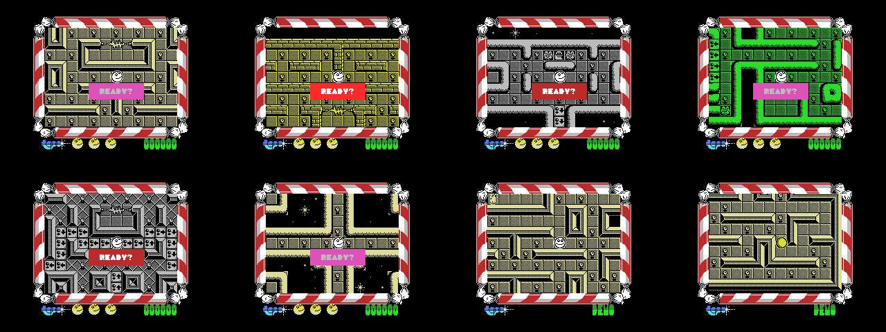
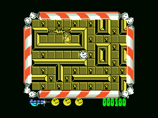

# Mad Mix Game v9990 (MSX1, GFX9000 y MSX2)

Versión mejorada de **Mad Mix Game** (Topo Soft, 1988) en un cartucho megaROM ASCII16 de 256 KB. El mismo cartucho elige cómo se juega según la máquina:

| Máquina | Qué se ve |
| --- | --- |
| MSX con cartucho **GFX9000** (V9990) | Laberinto, muñecos, marco, marcador y portada con los gráficos del remake, scroll y sprites por hardware |
| **MSX2** con 128 KB de VRAM, sin GFX9000 | Partida en SCREEN 5 con los gráficos del MSX1, a la misma velocidad |
| **MSX1** (64 KB de RAM) | El juego original optimizado y con sus fallos arreglados |

En el menú, la opción **3** alterna entre *Mad Mix Game* y *The Pepsi Challenge*, la versión inglesa con la mascota de Pepsi (con GFX9000 y en MSX1).

| Fichero | Qué es |
| --- | --- |
| `releases/Mad_Mix_Game_v9990.rom` | La versión definitiva (ASCII16, 256 KB) |
| `releases/Mad_Mix_Game_v9990_volumen.rom` | Variante con los muñecos sombreados con volumen en la GFX9000 |

openMSX reconoce el mapper solo; si no, `-romtype ASCII16`. Para la GFX9000 hay que añadir la extensión `gfx9000`.

 

  

## Qué cambia respecto al original

- **Fallos del original arreglados:** una flecha pisada sin moverse se contaba otra vez y la fase podía acabar con una bolita sin comer; un bicho sin salida (la mariquita de la fase 14) atravesaba muros hasta fuera del laberinto; pila en `$F2FF` y contador del nivel 13 de la v2.0 de Manuel Pazos.
- **Optimizaciones:** actores más rápidos con un tic de ritmo fijo, volcado de la ventana sincronizado con el haz (sin cortes en el scroll), 50/60 Hz y R800 en turbo R.
- **Controles:** cursores y ESPACIO por defecto.
- **GFX9000:** fantasmas de colores como en Pac-Man, comecocos y mascota de Pepsi en rojo con el Super Coco, portada nueva y logo de Topo.

Todos los cambios, versión a versión, están en [`docs/RESUMEN.md`](docs/RESUMEN.md). El diseño técnico (mapa de memoria, VRAM, ganchos en el juego) está en [`docs/DISENO.md`](docs/DISENO.md).

## Qué hay en el repositorio

- `releases/`: las ROM ya montadas.
- `src/juego/`: fuentes del juego. Parten del desensamblado de raemca, con los cambios marcados con `PROYECTO`, y el código nuevo: `optimizaciones.asm`, `v9990*.asm`, `v9_portada.asm`, `msx2.asm`, `pepsi*.asm`, `volumen.asm` e `imagen_ram.asm`, que lo ensambla todo en sus direcciones de RAM.
- `src/rom/rom.asm`: cabecera y cargador del cartucho; detecta GFX9000 y MSX2.
- `tools/`: `build.py` monta la ROM; `graficos.py`, `niveles.py` y `lz.py` convierten los gráficos y mapas del remake.
- `graficos/remake/`: los gráficos del remake que usa la build.
- `pruebas/`: guiones de openMSX para capturas, perfiles y comparaciones.
- `docs/`: diario del proyecto, diseño, rendimiento, diferencias con The Pepsi Challenge, análisis de los gráficos del remake y capturas.

**No se incluyen los ficheros del juego original** (cintas ni ROM).

## Cómo montar la ROM

Hace falta [SjASMPlus](https://github.com/z00m128/sjasmplus) 1.24 en el `PATH` y Python 3 con `Pillow`.

```sh
python3 tools/build.py              # build/madmix_v9990.rom
python3 tools/build.py --volumen    # build/madmix_v9990_volumen.rom
python3 tools/build.py --pasarfase  # ROM de pruebas: F1 da la fase por completada
```

Las opciones renombran la ROM, así que la normal se compila la última. La build reproduce byte a byte los ficheros de `releases/`.

## Historial

El historial es el del trabajo real, reescrito para quitar las ROM del juego original y las intermedias. Cada entrega es un commit cuyo mensaje empieza por su versión (`f0` ... `f34`); `f34` es la versión publicada. La rama `msx1` guarda la versión solo MSX1 (`f0e`).

## Créditos

- Juego original: *Mad Mix Game*, Topo Soft, 1988. Programación «Raphael Gomezzz», gráficos Roberto P. Acebes, música «Comilonas» (según los créditos del propio juego).
- Desensamblado, etiquetas y comentarios de la base: Rafael Eduardo Martín Candial, [github.com/raemca/MSX_MadMixGame](https://github.com/raemca/MSX_MadMixGame) (CC BY-NC-SA 4.0).
- Corrección del nivel 13/14 y pila en `$F2FF`: Manuel Pazos (2013).
- Gráficos de la versión GFX9000: los del remake de Mad Mix Game de su grafista (2013-2015).
- Dirección, pruebas en máquina real y retoques: araubi.
- Código, herramientas y documentación: desarrollados con Claude (Anthropic).

## Licencia y avisos

- **Herramientas** (`tools/`, `pruebas/`): [MIT](LICENSE).
- **Fuentes y documentación** (`src/`, `docs/`, README): [CC BY-NC-SA 4.0](LICENSE-CC), la misma del desensamblado de raemca del que derivan.
- **Juego original y ficheros de `releases/`:** *Mad Mix Game* y *The Pepsi Challenge* son obra de Topo Soft (1988) y sus derechos son de sus titulares, igual que los datos del juego que hay en `src/juego/data/`. Los ficheros de `releases/` contienen el juego original modificado y no están cubiertos por ninguna de las licencias anteriores. Esta versión es un homenaje sin ánimo de lucro: no se reclama ningún derecho sobre el original, y los ficheros se retirarán si los titulares lo piden.
- **Gráficos del remake** (`graficos/remake/`): son de su autor y se usan con su permiso; no están cubiertos por las licencias anteriores.
- **Marcas:** Pepsi es una marca de sus titulares; se usa solo porque aparece en *The Pepsi Challenge* original.
